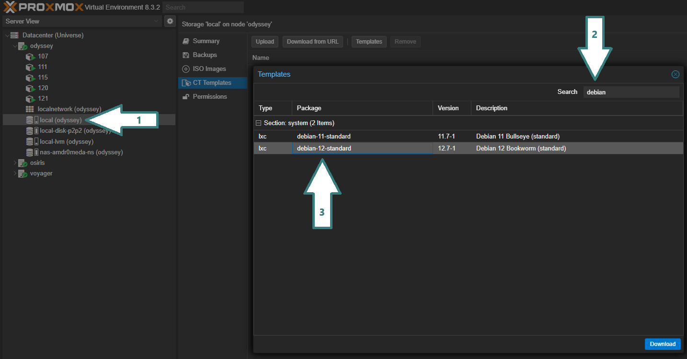

## 1. Crear un contenedor LXC en Proxmox

Si todavía no tienes descargada la plantilla de **Debian 12**, descárgala desde el menú de *CT Templates* (ver imagen) y úsala después en el asistente de creación del contenedor.



Requisitos mínimos:

- **1 GB** de RAM
- **1** núcleo
- **4 GB** de almacenamiento
- IP estática (fuera del rango DHCP del router)

> **Nota:** si tu ISP te da **IPv6**, configúralo también para que el router le entregue una dirección al contenedor.

## 2. Actualizaciones iniciales

Actualiza el contenedor con:

```bash
apt update && apt upgrade -y
```

> 🚧 **Artículo en proceso.** Seguiré completando esta guía con la instalación y el registro de la sonda.
