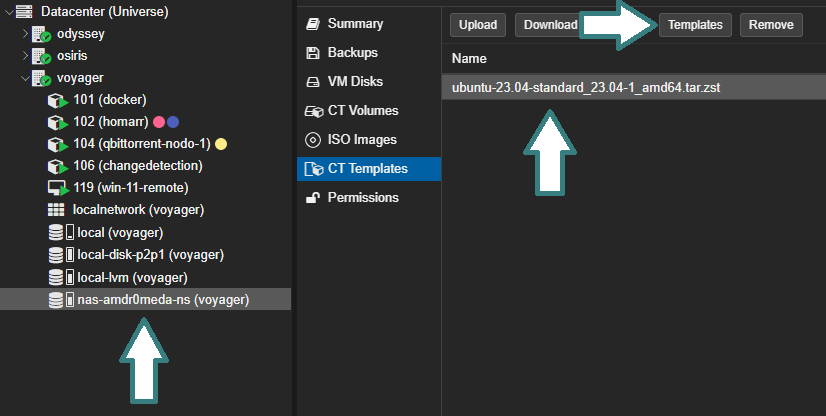
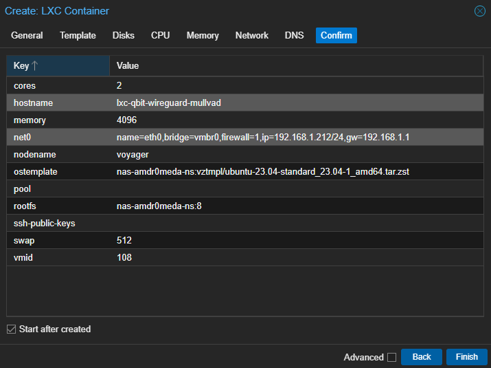
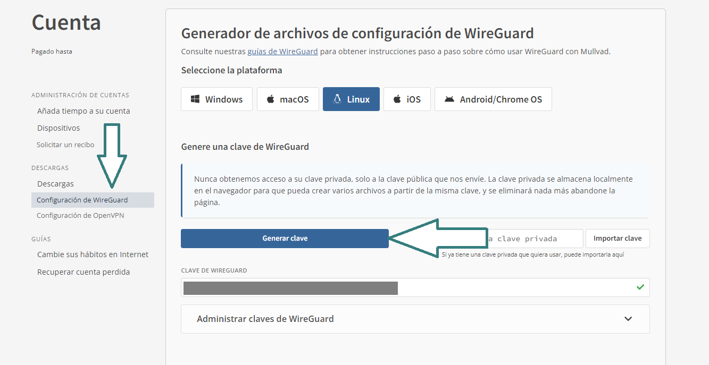
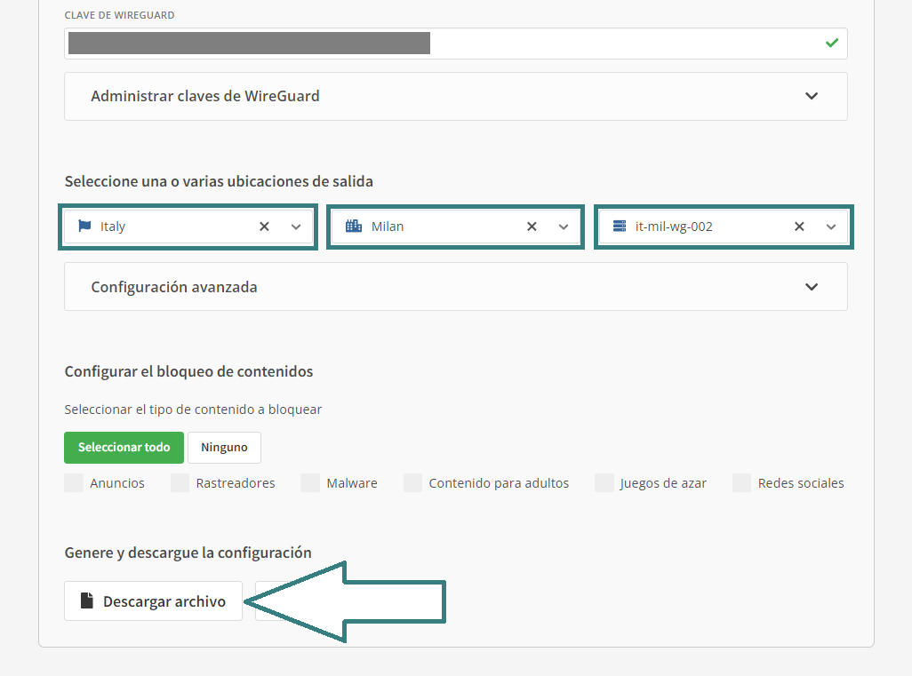
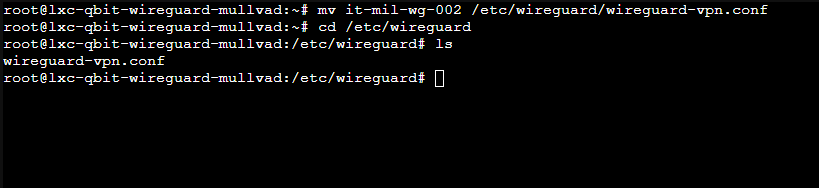
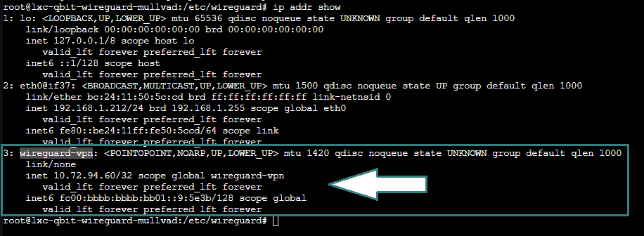
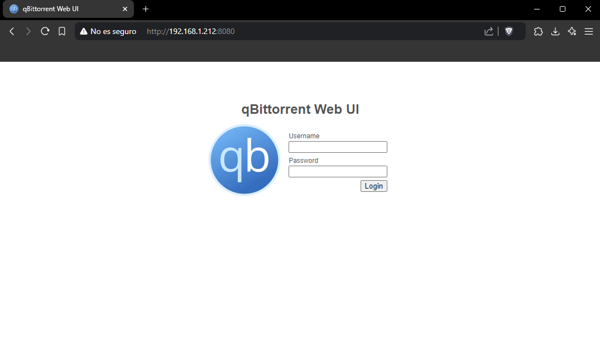
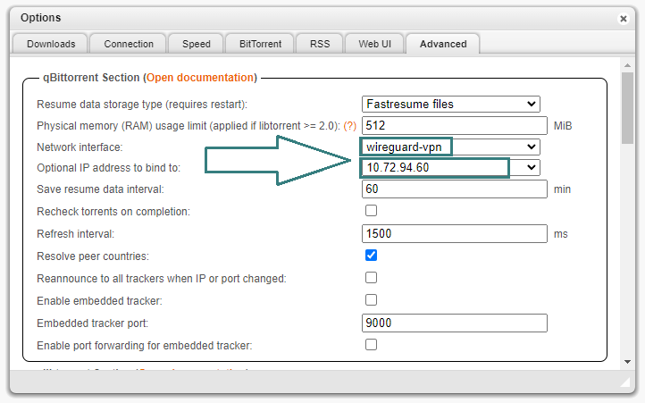

## 1. Crear el contenedor

Usaremos la plantilla de Ubuntu 23.04, `ubuntu-23.04-standard_23.04-1_amd64.tar.zst`. Se descarga desde la pestaña **CT Templates** de tu almacenamiento (en mi caso `nas-amdr0meda-ns`), pulsando el botón **Templates**.



Después creamos un contenedor LXC con esa plantilla; en mi caso con 2 núcleos, 4 GB de RAM y 512 MB de swap. Desmarco la opción de contenedor **sin privilegios** para tener acceso completo de escritura (útil si después quieres compartir los ficheros por Samba).



> **Nota:** en el ejemplo se asigna una IP fija (`192.168.1.212`). **Es recomendable asignar una IP fija al contenedor.**

## 2. Configuración inicial del contenedor

Inicia el contenedor y conéctate por consola con el usuario `root` y la contraseña que asignaste antes.

Antes de seguir, actualiza todos los paquetes:

```bash
apt update && apt upgrade -y
```

Instala WireGuard y sus herramientas, `curl`, `qbittorrent-nox`, `cifs-utils` e `iftop`:

```bash
apt install wireguard wireguard-tools curl qbittorrent-nox cifs-utils iftop
```

Con `cifs-utils` instalado puedes montar un recurso compartido (por ejemplo un NAS) donde guardar las descargas, u omitir este paso y usar el almacenamiento del propio contenedor.

> Si quieres usar almacenamiento compartido, añádelo como cualquier otro montaje en `/etc/fstab` y reinicia el contenedor al terminar:
>
> ```bash
> nano /etc/fstab
> ```

## 3. Configuración del túnel VPN (Mullvad)

Yo uso Mullvad como proveedor de VPN, pero la configuración es la misma con cualquier proveedor que ofrezca WireGuard; solo cambia la forma de obtener el fichero de configuración.

En la web de Mullvad ve a **Configuración de WireGuard** y pulsa **Generar clave**:



Más abajo elige país, ciudad y servidor, y descarga el fichero de configuración:



Copia el fichero al contenedor y muévelo a `/etc/wireguard/`:

```bash
mv FICHERO_DESCARGADO.conf /etc/wireguard/wireguard-vpn.conf
```



(En mi caso el fichero se llamaba `it-mil-wg-002`.)

## 4. Validación del túnel e inicio automático

Levanta el túnel:

```bash
wg-quick up wireguard-vpn
```

Comprueba que la interfaz está levantada con `ip addr show`:



Y habilita el servicio para que el túnel se levante automáticamente cada vez que arranque el contenedor:

```bash
systemctl enable wg-quick@wireguard-vpn
```

## 5. Configuración de qBittorrent (nox)

Hemos instalado la versión sin interfaz gráfica; la gestión se hace desde la interfaz web. Antes hay que crear un servicio de systemd para que qBittorrent arranque con el contenedor:

```bash
nano /etc/systemd/system/qbittorrent-nox.service
```

Con este contenido:

```ini
[Unit]
Description=qBittorrent-nox
Documentation=man:qbittorrent-nox(1)
Wants=network-online.target
After=network-online.target nss-lookup.target

[Service]
Type=exec
ExecStart=/usr/bin/qbittorrent-nox

[Install]
WantedBy=multi-user.target
```

Habilita el servicio y reinicia para comprobar que todo arranca solo:

```bash
systemctl enable qbittorrent-nox && reboot
```

> Con `&&` encadenas comandos: el segundo solo se ejecuta si el primero termina bien.

## 6. Vincular qBittorrent a la interfaz de WireGuard

Si todo ha ido bien, ya puedes entrar en la interfaz web de qBittorrent desde la IP del contenedor en el puerto 8080: `http://192.168.1.212:8080`.



El usuario por defecto es `admin` y la contraseña `adminadmin`. Es **muy recomendable** cambiar estas credenciales tras el primer acceso.

> En versiones recientes de qBittorrent (4.6.1 en adelante) ya no hay contraseña por defecto: se genera una temporal que aparece en el log del servicio (`journalctl -u qbittorrent-nox`).

En las opciones, ve a **Advanced** y selecciona como interfaz de red la del túnel VPN, y como dirección IP la que te asigna el túnel.



Con esto termina la configuración básica: a partir de ahora todos los torrents y magnets se descargarán a través del túnel VPN, y si el túnel cae qBittorrent dejará de tener conexión en lugar de salir por tu IP real.

¡Y eso es todo! Ya tienes un contenedor ligero desde el que gestionar tus descargas vía web, siempre a través de la VPN.
